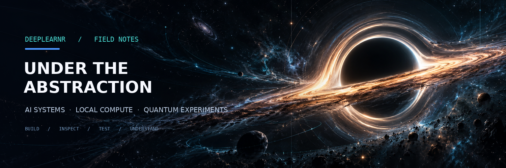

  

  <a href="https://github.com/deepLearnr/rbi-capstone">RBI Saathi</a> &nbsp;·&nbsp;
  <a href="https://github.com/deepLearnr/quantum-weather-prediction">Quantum Weather Prediction</a> &nbsp;·&nbsp;
  <a href="https://rbi-capstone.kalpeshw070.workers.dev/">Live demo</a>

## The part underneath the demo

I get interested when something works—and then want to know *why* it worked, what it silently assumes, and what makes it fail.

That tends to pull me below the interface: into retrieval and chunking, API and database boundaries, model behavior, memory limits, and the gap between an experiment that runs and a result that actually means something.

I'm moving toward **applied AI / GenAI development**, while going deeper into **machine learning and quantum-computing experiments**. I use AI-assisted coding tools, but I care about being able to trace the code, test the behavior, debug failures, and explain the decisions behind a system.

## Active lines of investigation

<table>
  <tr>
    <td width="50%" valign="top">
      01 / APPLIED GENAI · GROUP CAPSTONE
      <h3><a href="https://github.com/deepLearnr/rbi-capstone">RBI Saathi</a></h3>
      A regulatory-document assistant built around RBI material. My work has focused on backend and data-layer implementation: FastAPI document/chunk endpoints, PostgreSQL persistence, SQLAlchemy/Alembic, source metadata, and RAG-related integration.
        
      <a href="https://rbi-capstone.kalpeshw070.workers.dev/">Open the live demo ↗</a>
        
      FASTAPI · POSTGRESQL · DOCUMENT RETRIEVAL · SOURCE TRACEABILITY
    </td>
    <td width="50%" valign="top">
      02 / QUANTUM COMPUTING · ONGOING
      <h3><a href="https://github.com/deepLearnr/quantum-weather-prediction">Quantum Weather Prediction</a></h3>
      An exploratory attempt to understand where quantum methods might fit in a weather-prediction workflow. I'm studying the methods and working through project structure, local simulation limits, and how to compare experiments meaningfully.
        
      This is still in progress; planned approaches are not presented as validated results.
        
      PYTHON · QUANTUM SIMULATION · WEATHER DATA · COMPUTE CONSTRAINTS
    </td>
  </tr>
</table>

## Experiments, not just labels

- **Deep learning:** MNIST, dense-network baselines, rescaling, data augmentation, and training callbacks.
- **Local AI and systems:** Linux/Fedora, local model tooling, and investigation of hardware and memory constraints.
- **Backend engineering:** persistent data models, REST endpoints, migrations, tests, and source metadata.

## Current toolkit

`Python` `FastAPI` `PostgreSQL` `SQLAlchemy` `Alembic` `TensorFlow / Keras` `scikit-learn` `Git` `Linux / Fedora` `Docker`

These are tools I've used across projects and study—not a claim that I have equal depth in every one.

## A note on how I work

I prefer a test, a traceable source, a measured limitation, or a documented failure over a stack of badges. When I don't know how a part works, I want to find the boundary and investigate it.

This profile is a working notebook. I'll add results as the projects produce results worth showing.

---

  <a href="https://github.com/deepLearnr?tab=repositories">All repositories</a> &nbsp;·&nbsp; <a href="https://rbi-capstone.kalpeshw070.workers.dev/">RBI Saathi demo</a>

